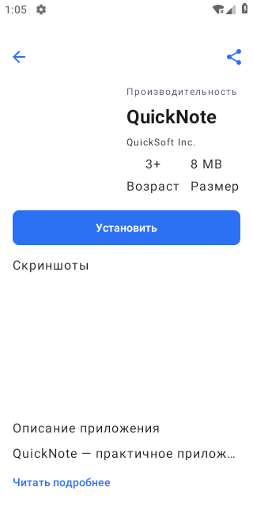
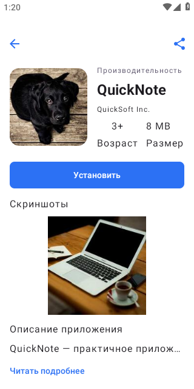
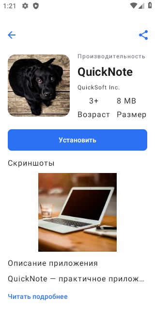
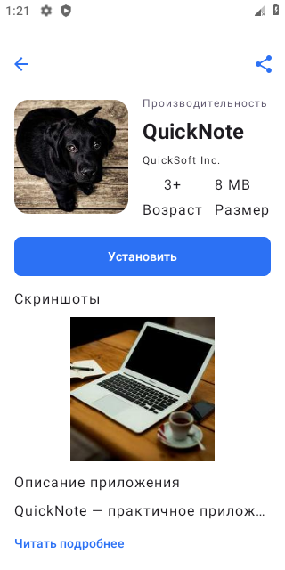

# Скриншоты для практикума лекции 8

Этот checklist относится к задаче восстановления screenshots flow для карточки QuickNote (`fa2e31b8-1234-4cf7-9914-108a170a1b01`) в VkEducation. Добавляйте в PR только кадры, сделанные на указанной в PR ревизии.

## Что приложить

1. **Baseline:** экран карточки до правки, если приложение и API удаётся запустить. Кадр показывает исходное поведение; не ретушировать и не подменять отсутствующие изображения.
2. **Исправленный UI:** та же серверная карточка с реальными изображениями, загруженными по URL из API.
3. **Cache backfill:** cache row с `screenshots = null` до открытия экрана после обновления приложения и экран после успешной загрузки недостающих URL.
4. **Повторное чтение:** лог/скриншот проверки второй DAO emission или перезапуска, показывающий, что повторное чтение cache не запускает новые API calls в рамках подписки. Если это неразличимо на кадре UI, приложите соответствующий тестовый вывод.

## Ручная проверка старого cache row

Чтобы создать запись исходной версии с отсутствующими screenshots, установите baseline APK, откройте карточку online и дождитесь записи Room. Затем обновите приложение до изменённой сборки через `adb install -r`, не очищая app data. Откройте карточку online: старый row должен получить недостающие URL. После этого отключите сеть и откройте экран повторно, чтобы проверить чтение URL из существующего Room cache.

```bash
# Пример: APK baseline и новый APK должны иметь тот же applicationId и signing key.
adb install -r path/to/updated-debug.apk
```

Не выполняйте `adb shell pm clear` между baseline установкой и обновлением: очистка удалит старую null cache-запись и сценарий backfill уже не проверится. Для чистого happy-path теста можно очистить данные до первого запуска исправленной версии:

```bash
adb shell pm clear io.mmaltsev.vkeducation
```

Room cache содержит URLs, а не байты изображений. Наличие URL в Room не гарантирует их offline отображение: загрузка и image cache принадлежат Coil. Подписывайте в PR отдельно факт чтения URL из Room и факт отрисовки Coil offline, если оба действительно проверялись.

## Когда API или эмулятор недоступны

Сохранённый JSON ответа QuickNote в `app/src/test/resources/catalog-response.json` подтверждает форму API-контракта и подходит для DTO contract test. Он не заменяет ручной запуск приложения. Не создавайте synthetic screenshots/URLs и не заявляйте, что online, backfill или offline сценарий выполнен. Укажите, что осталось непроверенным, и приложите доступные тесты DTO, Room mapper и repository.

## Выполненная проверка — 11 октября 2026

Baseline: `8bc6db1224108c3309f90c4e7ad1f935d9e5fb30`. Java 17, SDK 35, отдельный arm64 эмулятор API 28.

- `:app:testDebugUnitTest`: 15 passed (14 новых + исходный 1).
- `:app:assembleDebug`: успешно.
- `:app:lintDebug`: 0 errors, 45 warnings.
- `:app:connectedDebugAndroidTest`: 4 passed (3 новых + исходный 1). Compose tests проверяют наличие секции и передачу пяти элементов pager; remote bitmap проверен вручную.
- На baseline создана Room-запись QuickNote с `screenshots = null`. Обновление APK без очистки данных заполнило тот же row всеми пятью URL.
- Online вручную просмотрены все пять картинок. API отдаёт демонстрационные фотографии Picsum.
- После отключения Wi-Fi/mobile data (`Active default network: none`) и force-stop экран открылся из кеша; первая ранее загруженная картинка отрисована. Это проверка существующего Coil cache, а не обещание доступности изображений offline без предварительной загрузки.

Первоначально изображения не загружались из-за DNS эмулятора. Перезапуск отдельного AVD с `-dns-server 8.8.8.8` решил проблему; изменения сетевого кода приложения не понадобились. Диагностическое логирование в итоговый source не входит.

| Baseline | Исправленная галерея | Пятая страница | После перезапуска без сети |
|---|---|---|---|
|  |  |  |  |

Кадры реального эмулятора сняты через adb, без дорисовки. Room schema/dependencies не изменены.
